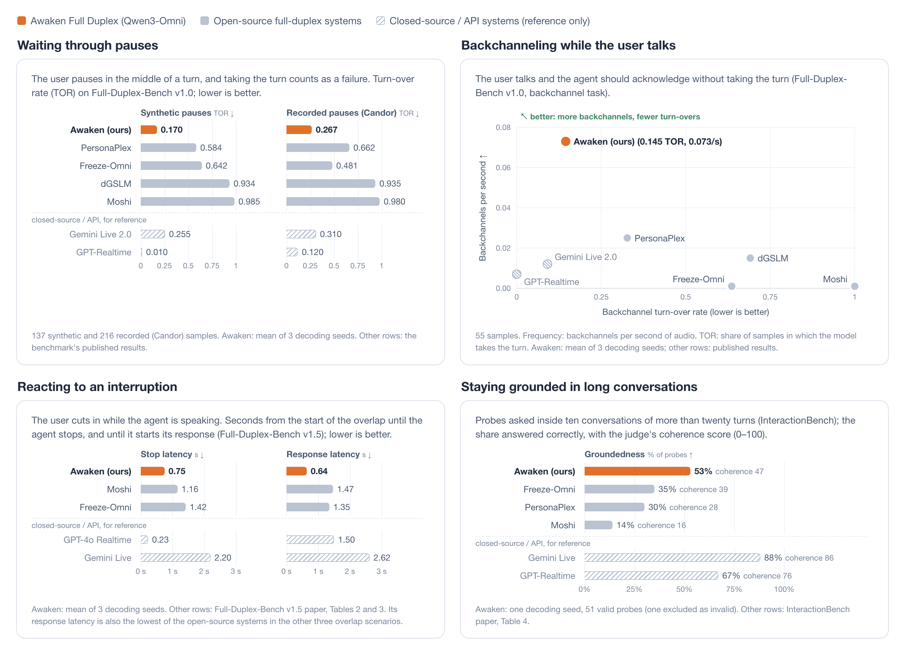
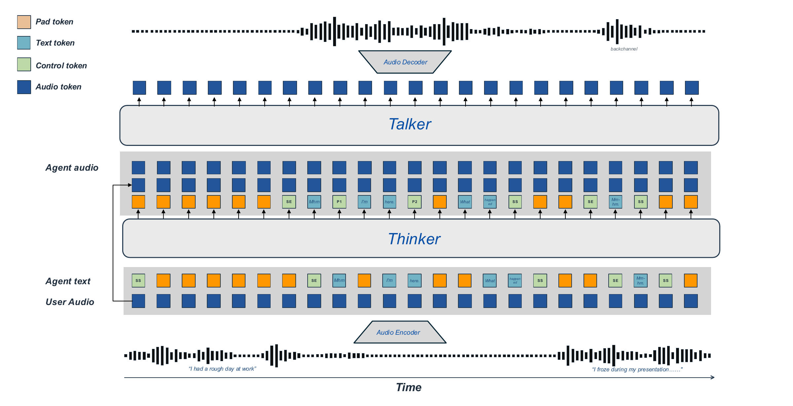
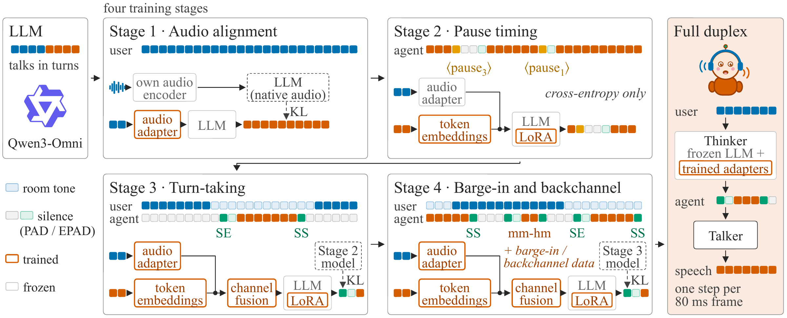

# Awaken Full Duplex — Based on Qwen3-Omni

<div align="center">

**An LLM Is All You Need: Data-Efficient Adaptation to Full-Duplex, Word-Level Spoken Dialogue**

[](https://avera-labs.github.io/AwakenFullDuplex-Qwen3Omni/)
[](https://github.com/avera-labs/AwakenFullDuplex-Qwen3Omni)
[](https://huggingface.co/openmartdev/AwakenFullDuplex-Qwen3Omni)
[](https://huggingface.co/Qwen/Qwen3-Omni-30B-A3B-Instruct)
<!-- TODO(arXiv): there is no arXiv id yet. Once there is one, add this badge here:
[](https://arxiv.org/abs/XXXX.XXXXX) -->

Tairan Chen, Richard Yucheng He, Yihang Liu, Baodong Cao, Chen Xu · [AveraLabs](https://averalabs.com/)

</div>

## Model Description

Full-duplex voice models can listen and speak at the same time, so they can backchannel, yield the floor when they
are interrupted, and take it back, the way people do. This behavior is usually learned by training on hundreds of
thousands to millions of hours of speech. That training is costly and rewrites the language model that supplies the
system's knowledge, and turn-taking still ends up implicit or decided coarsely rather than word by word. **Awaken is
based on [Qwen3-Omni](https://huggingface.co/Qwen/Qwen3-Omni-30B-A3B-Instruct)**, keeping the multimodal LLM frozen
and adapting it with little data into the thinker of a word-level full-duplex thinker–talker system on an 80 ms frame
clock, while a separate talker turns the thinker's tokens into speech.

<p align="center">
  
</p>

### Key Features

- **Data-efficient**: Keeps [Qwen3-Omni-30B-A3B](https://huggingface.co/Qwen/Qwen3-Omni-30B-A3B-Instruct) frozen
  and trains only 97.4M parameters: attention LoRA (13.4M), a user-audio adapter (75.5M), a channel-fusion layer
  (8.4M) and 17 timing-token embeddings. A four-stage curriculum performs the conversion in about 30 GPU-hours (30.5
  on one NVIDIA B200), and no training run uses more than a few tens of thousands of dialogues. The adaptation needs no
  large-scale speech training (Qwen3-Omni itself was pretrained on large amounts of audio).
- **Word-level turn-taking**: Every 80 ms the thinker emits one token of agent text. Pauses, yields (`SS`) and onsets
  (`SE`) are tokens of the same vocabulary, and a finite-state machine masks illegal tokens before sampling. The model
  decides every turn itself, with no external voice-activity detector.
- **Competitive with large-scale speech training**: Among open-source full-duplex systems, it is the least likely to
  take the floor when the user merely pauses (turn-over rate **0.170**, against 0.584 for the next best) and it
  backchannels most often (**0.073** per second) on Full-Duplex-Bench v1.0. Among them, it also has the lowest response
  latency in every overlap scenario of Full-Duplex-Bench v1.5. On InteractionBench it leads them on groundedness
  (**53%**, against 35% for the next best), coherence (**47**) and spoken tasks (**26%**).

<p align="center">
  
</p>

### Training Recipe

<p align="center">
  
</p>

The LLM's weights, token embeddings and language-modeling head stay frozen throughout. Each stage trains a few added
parameters and starts from the one before it; from Stage 3 on, a KL term at word positions holds what the model says
close to the model the stage started from.

1. **Stage 1, audio alignment**: trains only the audio adapter, first as a speech-recognition read-out on 17,210
   windows of user speech, then by distillation against the frozen LLM listening through its own audio encoder.
2. **Stage 2, pause timing**: adds `PAD`, `EPAD` and 13 pause tokens with rank-16 LoRA, on 760 single-turn spoken
   questions whose answers carry word-level pauses.
3. **Stage 3, turn-taking**: adds `SS` and `SE` and moves to the two-channel format, by self-distillation and then a
   multi-turn retrain on 12,146 dialogues that also trains the channel-fusion layer and the audio adapter.
4. **Stage 4, barge-in and backchannel**: trains on 36,621 dialogues with injected user interruptions, then on 42,229
   sequences: those dialogues plus 701 backchannel dialogues repeated eight times.

The **talker** is trained separately, in one supervised stage of 2.65 hours on one NVIDIA B200, on 36,996 examples of
synthesized dialogue speech. Their word-level transcripts use the thinker's token format, so no thinker is needed to
make the data.

See the paper for the data and training details; the
[project page](https://avera-labs.github.io/AwakenFullDuplex-Qwen3Omni/) has an overview.

## Model Details

| Attribute | Value |
|-----------|-------|
| Model Size | Thinker: frozen Qwen3-Omni-30B-A3B thinker + 97.4M trained parameters; talker: 8-layer temporal (width 4,096) + 6-layer depth transformer (width 1,024) |
| Base Model | [Qwen3-Omni-30B-A3B-Instruct](https://huggingface.co/Qwen/Qwen3-Omni-30B-A3B-Instruct) (turn-based, kept frozen); talker lineage from [PersonaPlex](https://github.com/NVIDIA/personaplex) |
| Backbone | Qwen3-Omni-30B-A3B mixture-of-experts thinker, one position per 80 ms frame (12.5 Hz) |
| Input | Streaming 24 kHz user audio, encoded by the frozen [Mimi](https://huggingface.co/kyutai/moshiko-pytorch-bf16) codec (8 codebooks per frame) and read through a trained audio adapter |
| Output | One agent-text token per frame; a Moshi-style talker voices it 3 frames (240 ms) later as 8 Mimi codebooks, decoded to 24 kHz speech |
| Interaction | Full-duplex: backchannels, yields to barge-in and takes the floor back; no voice-activity detector |
| Languages | English |
| License | Code: Apache 2.0. Weights: pending (see [License](#license)) |

## Requirements

- Linux with one NVIDIA GPU and a driver that supports CUDA 12.8
- Measured on one H200 (141 GB): the demo peaked at about 112 GB, more than an 80 GB card holds (the thinker's bf16
  weights alone take about 60 GB), and ran at a real-time factor of about 0.66 (p90 per-frame compute 52.6 ms per 80 ms
  frame)
- Python 3.10
- PyTorch 2.8 with CUDA 12.8 (uv installs the cu128 wheels)
- [uv](https://docs.astral.sh/uv/)

## Installation

```bash
git clone https://github.com/avera-labs/AwakenFullDuplex-Qwen3Omni
cd AwakenFullDuplex-Qwen3Omni

uv sync                        # .venv with Python 3.10; torch cu128 wheels come from the PyTorch index
source .venv/bin/activate      # puts awaken-server, awaken-offline, awaken-client and hf on PATH
```

uv is required: `moshi==0.2.13` declares `huggingface-hub<1.0` while transformers 5.x needs 1.x, and `pyproject.toml`
overrides that bound for uv, which pip cannot do.

## Quick Start

### Download Models

```bash
hf download openmartdev/AwakenFullDuplex-Qwen3Omni --local-dir ./pretrained_models/awaken-omni
```

`hf` comes with `huggingface-hub`, a dependency of this package, so it is on PATH in the activated venv. The download
is about 7.9 GB: the thinker, the talker, the default voice prompt and two tables. The
[model card](https://huggingface.co/openmartdev/AwakenFullDuplex-Qwen3Omni) lists the files. `pretrained_models/` is
git-ignored.

The base models are fetched from Hugging Face automatically on first use:
[`Qwen/Qwen3-Omni-30B-A3B-Instruct`](https://huggingface.co/Qwen/Qwen3-Omni-30B-A3B-Instruct) (about 70 GB) and the
Mimi codec from [`kyutai/moshiko-pytorch-bf16`](https://huggingface.co/kyutai/moshiko-pytorch-bf16).

### Inference

Live server with the browser client built in (one conversation at a time, WebSocket protocol in
`src/duplexaudio/serving/realtime/protocol.py`):

```bash
awaken-server --model ./pretrained_models/awaken-omni --port 8998
# remote GPU box: ssh -L 8998:localhost:8998 <gpu-box>, then open http://localhost:8998 in Chrome or Edge
```

`--model` also takes the Hugging Face repo id (`--model openmartdev/AwakenFullDuplex-Qwen3Omni`), which fetches only
`checkpoints/` and `data/` into the Hugging Face cache. The first start checks the md5 pins, loads the weights,
compiles and warms up, which takes a few minutes. The server binds loopback only by default. There is no
authentication, and every conversation is recorded under `logs/demo/sessions/` (in `$DUPLEX_RUNTIME_ROOT`, else the
repository root, never in the model folder; `--rec-root DIR` changes it). Use headphones, or keep the page's default
noise suppression and echo cancellation.

Headless client, which streams a wav file through a running server (`--url`, default `ws://127.0.0.1:8998/ws`) at
real-time pace:

```bash
awaken-client --wav in.wav --out client_out/   # client_out/stereo.wav (L user, R agent), agent.wav, client.json
```

Offline, with a recorded user track (one process, no server):

```bash
awaken-offline --model ./pretrained_models/awaken-omni --input user.wav --out offline_out/   # stereo.wav, transcript.txt, recordings
```

`--out` must be a new or empty folder. `stereo.wav` has the user on the left and the agent on the right, and
`transcript.txt` holds the agent's text, one line per turn.

From Python:

```python
from duplexaudio import RealtimeEngine, load_profile, set_model_dir

set_model_dir("./pretrained_models/awaken-omni")   # or the HF repo id; call before load_profile / RealtimeEngine
eng = RealtimeEngine(load_profile("default"))
eng.run(eng.load)                                  # md5 pins, weights, compile + warm-up (a few minutes)
sess = eng.run(eng.new_session, "demo")            # clean context + per-conversation seeds
for frame in frames:                               # float32 (1920,): 80 ms of 24 kHz mono user audio
    out = eng.run(sess.tick, frame)                # out.pcm: int16 agent audio of out.agent_frame; out.text, out.kind
eng.run(sess.flush)                                # voice the talker's last words after the input ends
meta = eng.run(sess.finalize, "stop")              # grammar + talker-input checks, timings, recordings
```

## Evaluation

We run the full system end to end on two external benchmarks of real-time behavior. The thinker produces the
agent-text stream from the user audio, the talker voices it, and each benchmark's own transcription and evaluation
scripts score the result without modification. No external voice-activity detector is used. The Awaken numbers are
from our runs; every other number is the benchmark's published result. Closed-source API systems are marked "API" and are
shown for reference only; the comparisons in the paper are with the open-source systems.

**Full-Duplex-Bench v1.0** (TOR = turn-over rate; latencies in seconds)

| Task | Metric | **Awaken** | PersonaPlex | dGSLM | Moshi | Freeze-Omni | Gemini Live 2.0 (API) | GPT-Realtime (API) |
|------|--------|-----------:|------------:|------:|------:|------------:|----------------------:|-------------------:|
| Pause handling | Synthetic TOR ↓ | **0.170** | 0.584 | 0.934 | 0.985 | 0.642 | 0.255 | 0.010 |
| | Candor TOR ↓ | **0.267** | 0.662 | 0.935 | 0.980 | 0.481 | 0.310 | 0.120 |
| Backchannel | TOR ↓ | **0.145** | 0.327 | 0.691 | 1.000 | 0.636 | 0.091 | 0.000 |
| | Frequency ↑ | **0.073** | 0.025 | 0.015 | 0.001 | 0.001 | 0.012 | 0.007 |
| | JSD ↓ | **0.753** | 0.649 | 0.934 | 0.957 | 0.997 | 0.896 | 0.980 |
| Smooth turn-taking | TOR ↑ | **0.997** | 0.992 | 0.975 | 0.941 | 0.336 | 0.655 | 1.000 |
| | Latency ↓ | **0.44** | 0.070 | 0.352 | 0.265 | 0.953 | 1.301 | 1.470 |
| User interruption | TOR ↑ | **0.998** | 1.000 | 0.917 | 1.000 | 0.867 | 0.891 | 0.970 |
| | Relevance (0–5) ↑ | **2.681** | 4.210 | 0.201 | 0.765 | 3.615 | 3.376 | 3.850 |
| | Latency ↓ | **0.598** | 0.400 | 2.531 | 0.257 | 1.409 | 1.183 | 1.500 |

**Full-Duplex-Bench v1.5** (behavior after an overlap; latencies in seconds from the start of the overlap)

| Scenario | Metric | **Awaken** | Freeze-Omni | Moshi | Gemini Live (API) | GPT-4o Realtime (API) |
|----------|--------|-----------:|------------:|------:|------------------:|----------------------:|
| User interruption | Response ↑ | **0.42** | 0.72 | 0.50 | 0.33 | 0.78 |
| | Resumption ↓ | **0.10** | 0.12 | 0.26 | 0.55 | 0.10 |
| | Stop ↓ / response ↓ latency | **0.75 / 0.64** | 1.42 / 1.35 | 1.16 / 1.47 | 2.20 / 2.62 | 0.23 / 1.50 |
| User backchannel | Response ↓ | **0.02** | 0.07 | 0.02 | 0.01 | 0.03 |
| | Resumption ↑ | **0.24** | 0.80 | 0.06 | 0.93 | 0.70 |
| | Stop ↑ / response ↓ latency | **0.68 / 1.33** | 0.66 / 2.16 | 0.42 / 3.00 | 0.66 / 2.45 | 0.21 / 1.32 |
| Side conversation | Response ↓ | **0.08** | 0.58 | 0.20 | 0.00 | 0.91 |
| | Resumption ↑ | **0.25** | 0.25 | 0.19 | 0.99 | 0.02 |
| | Stop ↑ / response ↓ latency | **0.84 / 0.62** | 1.39 / 1.32 | 0.87 / 2.38 | 1.69 / 1.78 | 0.18 / 1.16 |
| Background speech | Response ↓ | **0.06** | 0.63 | 0.21 | 0.70 | 0.93 |
| | Resumption ↑ | **0.23** | 0.25 | 0.07 | 0.30 | 0.04 |
| | Stop ↑ / response ↓ latency | **0.83 / 0.64** | 0.98 / 1.60 | 0.54 / 1.62 | 0.95 / 2.38 | 0.18 / 1.26 |

**InteractionBench** (percent of the items in each dimension, counts in parentheses)

| System | Spoken task ↑ | Timing ↑ | Whisper & volume ↑ | Grounded ↑ | Coherence (0–100) ↑ |
|--------|--------------:|---------:|-------------------:|-----------:|--------------------:|
| Moshi | 6 (3/50) | 41 (54/132) | 15 (3/20) | 14 (7/50) | 16 |
| PersonaPlex | 18 (9/50) | 68 (90/132) | 35 (7/20) | 30 (15/50) | 28 |
| Freeze-Omni | 8 (4/50) | 57 (78/138) | 15 (3/20) | 35 (18/51) | 39 |
| **Awaken** | **26 (13/50)** | **63 (88/140)** | **5 (1/20)** | **53 (27/51)** | **47** |
| GPT-Realtime (API) | 70 (35/50) | 70 (97/138) | 35 (7/20) | 67 (35/52) | 76 |
| Gemini Live (API) | 72 (36/50) | 77 (102/132) | 75 (15/20) | 88 (46/52) | 86 |

- **Full-Duplex-Bench v1.0** ([Lin et al., 2025](https://arxiv.org/abs/2503.04721)): 353 pause-handling samples (137
  synthetic and 216 recorded from Candor), 55 backchannel, 119 smooth turn-taking and 200 user-interruption samples.
  TOR is the share of samples in which the model takes the turn. Backchannel frequency counts backchannels per second
  of audio, and JSD is the Jensen–Shannon divergence between the timing of the model's backchannels and a human
  reference. After an interruption, the benchmark's LLM judge (GPT-4-turbo in its released script) rates relevance
  from 0 to 5. The Awaken column is the mean of three decoding seeds. Other columns are the benchmark's public results.
- **Full-Duplex-Bench v1.5** ([Lin et al., 2025](https://arxiv.org/abs/2507.23159)): the model is speaking when the
  overlap begins. Its speech afterwards is classified as a response to the overlap or a resumption of what it was
  saying (the uncertain and unknown classes are omitted). A model should respond to an interruption but keep going
  after a backchannel, a side conversation or background speech, so the arrows give the desirable direction for each
  scenario. The Awaken column is the mean of three decoding seeds. Other columns are from Tables 2 and 3 of the v1.5
  paper.
- **InteractionBench** ([He et al., 2026](https://arxiv.org/abs/2611.02430)) drives every system through the same
  recorded user audio: 221 items over thirteen scenarios. Groundedness probes are asked inside ten conversations of
  more than twenty turns, and coherence is the judge's mean score over those conversations. The Awaken row is a single
  decoding seed. It is graded on the thinker's text stream, with each word timed at the frame in which the thinker
  emits it; grader components that read audio use the talker's output, cut at those times. One of its 52 probes was
  excluded as invalid. Other rows are from Table 4 of the benchmark paper.

Bold marks our row or column, not the best value. Awaken is weaker in places. On Full-Duplex-Bench v1.0, PersonaPlex
and Moshi respond faster, both when the user finishes a turn and after an interruption; PersonaPlex's backchannel
timing is closer to the human reference; and our responses after an interruption are rated less relevant than
PersonaPlex's and Freeze-Omni's. On v1.5 it responds to an interruption less often than Freeze-Omni and Moshi, and
after a user backchannel it resumes its earlier utterance far less often than Freeze-Omni (0.24 against 0.80). On
InteractionBench it is the weakest on whisper and volume, which the talker does not control.

The per-behavior sets are small (55 to 353 items on Full-Duplex-Bench, 10 to 140 on InteractionBench), so a difference
of a few points is within run-to-run variation. Our rows come from our own runs and the other rows from the published
results, and on InteractionBench our row is graded on the thinker's text stream, so compare across systems with care.
The per-seed values are in the paper's appendix, and the
[project page](https://avera-labs.github.io/AwakenFullDuplex-Qwen3Omni/) has an overview.

## Inference Details

<details>
<summary>How the inference stack works</summary>

Every 80 ms ("one frame", 12.5 Hz) the engine

* encodes the newest 80 ms of user audio with Mimi's streaming encoder into 8 codebook indices. The thinker's
  **audio adapter** embeds them, and the **channel-fusion** layer combines them with the agent's previous token;
* runs one step of the frozen **Qwen3-Omni thinker** (with LoRA) and samples one agent token under the
  **turn-taking state machine**'s mask. The token is a word piece, a pause token, `PAD` (nothing new this frame),
  `SS` (silence start: the agent yields) or `SE` (silence end: the agent takes the floor). While the agent is silent
  the only legal choice is `PAD` or `SE`; within its turn, the choice is a word, a pause or `SS`;
* passes the token id to the **talker**, which reads the text 3 frames (240 ms) ahead of the audio it produces. A
  canonicalizer table (`data/talker_canon.json`) maps thinker tokens the talker never saw in training onto ones
  it did, and pause tokens reach it as `PAD`. One step of its temporal transformer and depth transformer emits the 8
  Mimi codebooks of the next agent frame;
* decodes those codes with Mimi's streaming decoder into agent speech.

```
mic 24 kHz ─► Mimi encoder ─► 8 user codes / frame ─► audio adapter ─┐
                                                                     ▼
          previous agent token ─────────────────────────────► channel fusion
                    ▲                                                │
                    │                                                ▼
                    │                           Qwen3-Omni-30B-A3B thinker (frozen) + LoRA
                    │                                                │  state-machine mask
                    │                                                ▼
                    └──────────────────────── next agent token: word / pause / PAD / SS / SE
                                                                     │  token ids only
                                                                     ▼
                                         talker: temporal + depth transformer, text 3 frames ahead
                                                                     │  8 agent codes / frame
                                                                     ▼
                                                               Mimi decoder ─► speaker
```

Both halves run a step every frame, including during silence, which is what lets the agent be interrupted and
backchannel. The user channel is never muted or gated. Every CUDA call of a conversation runs on one GPU thread
(`src/duplexaudio/serving/realtime/engine.py`), and the thinker's single-frame step is CUDA-graphed
(`src/duplexaudio/inference/thinker/fast_thinker.py`).

</details>

<details>
<summary>Decode parameters</summary>

One profile, `src/duplexaudio/serving/realtime/profiles/default.yaml`, fixes the released files and every decode
setting. The loader rejects missing and unknown keys, so no value can drift in silently from code.

| Part | Setting | Value |
|------|---------|-------|
| Thinker | temperature while silent (whether to take the floor) | 0.0 (greedy) |
| | temperature while speaking | 0.2 |
| | repetition control | penalty 1.2 on the last 24 tokens, no repeated 3-gram |
| | `SS` / `SE` logit bias | 0.0 / 0.0 |
| | KV cache | 4,096 positions |
| Talker | text lead | 3 frames (240 ms) |
| | sampler | temperature 0.8, top-k 250 |
| | voice prompt | `data/default_vp_codes.npy` with its frame-aligned transcript `data/default_vp_text.npy` |
| Front end | room-tone floor under the user channel | −78 to −63 dBFS, as in the Stage-4 training data |
| Session | length cap | 3,000 frames (240 s), lowered to what the caches can hold |

To change a setting, or to use your own voice prompt, copy the profile, edit it (paths and md5s) and pass
`--profile path/to/profile.yaml`. Profile paths are not relative to the working directory: `data/...` and
`checkpoints/...` resolve inside the `--model` folder, so give your own files as absolute paths.

</details>

<details>
<summary>Model folder and file pins</summary>

`--model DIR` (or `set_model_dir`) serves the model files from a folder laid out like the Hugging Face repo:

```
checkpoints/thinker/model.pt                          thinker: audio adapter, channel fusion, LoRA and timing-token weights
checkpoints/thinker/persona.txt                       thinker system prompt
checkpoints/talker/model.safetensors                  talker
data/thinker_text_emb.pt                              the thinker's token-embedding table, read by the talker at load
data/default_vp_codes.npy, data/default_vp_text.npy   default voice prompt: Mimi codes + frame-aligned transcript
data/talker_canon.json                                talker input canonicalizer table
```

Every file above except `data/thinker_text_emb.pt` is md5-pinned in the profile, as is `configs/talker.yaml` in this
repository, and the engine refuses to start on a mismatch. Without `--model`, the files are read from `checkpoints/`
and `data/` under `$DUPLEX_RUNTIME_ROOT`, else under the repository root; if neither folder is there,
`awaken-server` and `awaken-offline` stop at once and ask for `--model`.

</details>

<details>
<summary>Repository layout</summary>

```
src/duplexaudio/
  __init__.py               the Python API: RealtimeEngine, load_profile, set_model_dir
  common/paths.py           repository, runtime and model-folder paths (set_model_dir)
  models/thinker/           timing tokens, text format, user-audio front end, LoRA, dense mixture-of-experts forward
  models/talker/            the talker: a Moshi LMModel whose text input is the thinker's token stream
  inference/thinker/        frame-by-frame KV-cached engine, CUDA-graphed step, turn-taking state machine, loader
  inference/talker/         talker loader, inputs, voice prompt, canonicalizer table, sampler
  serving/realtime/         profile, engine, session loop, streaming Mimi, thinker and talker steps,
                            server.py (awaken-server, browser client in static/), offline.py (awaken-offline),
                            client.py (awaken-client)
    profiles/default.yaml   the released profile: file pins and every decode setting
configs/talker.yaml         talker architecture (md5-pinned by the profile)
tests/                      CPU tests, no GPU or checkpoints needed
hf_model_card/              Hugging Face model card (README + figures)
index.html                  project page
```

Run the tests with `uv sync --extra dev && pytest`.

</details>

## License

The code is licensed under the [Apache 2.0 License](LICENSE).

The model weights are distributed separately on
[Hugging Face](https://huggingface.co/openmartdev/AwakenFullDuplex-Qwen3Omni), and their license has not been decided
yet. They build on work under different terms: the talker's lineage begins from NVIDIA
[PersonaPlex](https://github.com/NVIDIA/personaplex); the Moshi and Mimi weights are CC-BY 4.0; the
[Qwen3-Omni](https://huggingface.co/Qwen/Qwen3-Omni-30B-A3B-Instruct) base model is Apache 2.0; and the default voice
prompt is synthesized with a commercial text-to-speech service, whose terms are being confirmed.<!-- TBD before publishing: confirm the TTS provider's terms for the voice prompt --> The base models downloaded at run time keep
their own licenses; see [`NOTICE`](NOTICE).

## Acknowledgments

The thinker is built on the frozen thinker of [Qwen3-Omni](https://huggingface.co/Qwen/Qwen3-Omni-30B-A3B-Instruct)
(Apache 2.0). The talker follows the architecture of [Moshi](https://github.com/kyutai-labs/moshi), and all audio goes
through Kyutai's Mimi codec (code MIT, weights CC-BY 4.0). The talker's lineage begins from NVIDIA's
[PersonaPlex](https://github.com/NVIDIA/personaplex), whose voice-prompt convention we follow. We evaluate on
[Full-Duplex-Bench](https://arxiv.org/abs/2503.04721) (v1.0 and [v1.5](https://arxiv.org/abs/2507.23159)) and
[InteractionBench](https://avera-labs.github.io/InteractionBench/). See [`NOTICE`](NOTICE).

## Citation

<!-- TODO(arXiv): add eprint = {XXXX.XXXXX}, archivePrefix = {arXiv} once the paper has an arXiv id. -->

```bibtex
@misc{chen2026llm,
  title        = {An {LLM} Is All You Need: Data-Efficient Adaptation to Full-Duplex, Word-Level Spoken Dialogue},
  author       = {Tairan Chen and Richard Yucheng He and Yihang Liu and Baodong Cao and Chen Xu},
  year         = {2026},
  howpublished = {\url{https://github.com/avera-labs/AwakenFullDuplex-Qwen3Omni}}
}
```

## Contact

- 🐛 Submit an [Issue](https://github.com/avera-labs/AwakenFullDuplex-Qwen3Omni/issues)
- 💡 Submit a [Pull Request](https://github.com/avera-labs/AwakenFullDuplex-Qwen3Omni/pulls)
